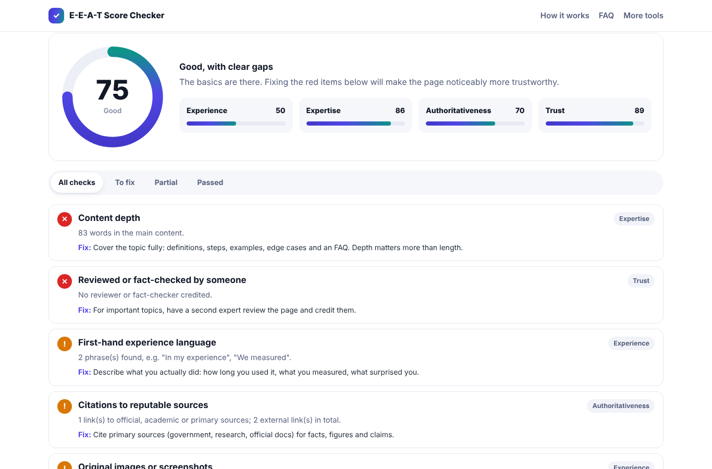

# E-E-A-T Score Checker

Audit a web page's Experience, Expertise, Authoritativeness and Trust signals and get a 0–100 score with clear fixes.

**Live demo:** https://harikabehara247.github.io/eeat-score-checker/

## Features

- 20 on-page checks across the four E-E-A-T pillars
- Per-pillar scores and an overall score
- Detects author bylines, Person/Organization schema, dates, citations to official sources, policies, affiliate disclosures and first-hand experience language
- Plain-English fix for every failed check
- Copy the report as text
- 100% client-side — the HTML you paste never leaves your browser

## How to use

Open the page you want to audit, press **Ctrl+U** (⌘⌥U on Mac), copy the full source and paste it into the tool. Add the page URL so internal and external links are told apart.

## Run it yourself

It is a single, dependency-free HTML file. Download `index.html` and open it in any modern browser, or host it on GitHub Pages, Netlify or your own site.

## Good to know

Google does not publish an E-E-A-T score. E-E-A-T comes from Google's Search Quality Rater Guidelines. This tool checks the *visible signals* that support it; it does not predict rankings.

## About

Built by **[Harika Behara](https://github.com/harikabehara247)** — a single-file, privacy-friendly tool for website owners and SEO professionals.

Issues and suggestions are welcome: open an issue on this repository.

## Licence

[MIT](LICENSE) © 2026 Harika Behara
